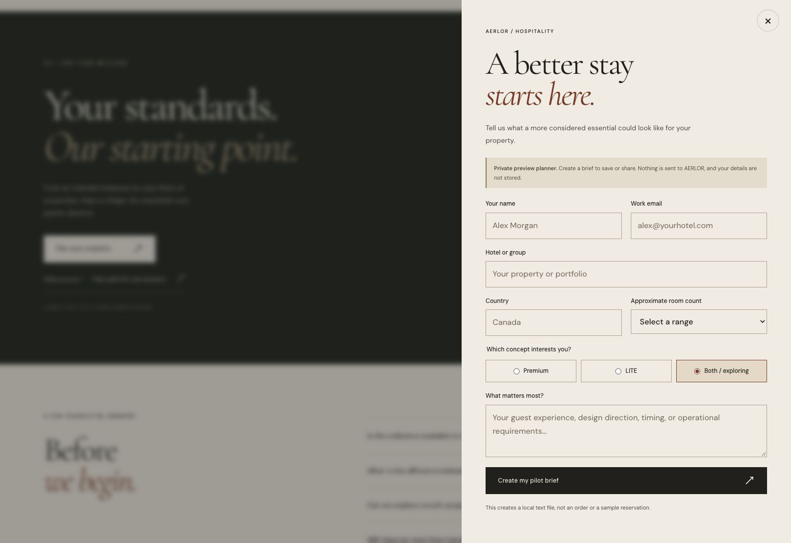

# SITE-04 prelaunch assurance — issue #17

**Review date:** 4 November 2026

**Claimed scope:** [issue #17](https://github.com/mastermindx-market-intelligence/aerlor/issues/17), linked to [SITE-04 #11](https://github.com/mastermindx-market-intelligence/aerlor/issues/11)

**Branch:** `work/site/prelaunch-assurance-20261104`

**Final source baseline:** `68f0ba1a3ed6746551460d772cb791eb050ee988`

**Status:** Reviewable assurance tests and evidence. Commercial approval is not established.

## Result

Six new offline checks cover a previously untested catalog release boundary and preview publication controls. The direct service tests reject all nine current product/finish combinations in both synthetic test and live configurations: 18 checkout attempts total, with zero injected provider calls or transaction-store accesses. An otherwise eligible configuration is demonstrated using a catalog copy changed only in memory; no checkout is attempted on that positive control.

The existing build, 11 contract tests and 39 domain/server tests pass in this environment. The new six tests also pass. Local automated browser execution could not start; this report does not substitute another session's Chromium/WebKit results for our own execution.

## Ownership and baseline reconciliation

The original session began from main `632c79717d8bd0657ac8c93fa6397533cbe16ce0`, after reading the bootstrap material, live issues, PR #1 and company Notion HQ. The primary implementation owner was already working on `work/site/hospitality-commerce-r3`, tracked by [PR #16](https://github.com/mastermindx-market-intelligence/aerlor/pull/16). We claimed only the additive assurance task in issue #17 and [recorded it on #11](https://github.com/mastermindx-market-intelligence/aerlor/issues/11#issuecomment-6628439848).

Main advanced to R3 commit `2d6d5fe47c9036d311622e0436ed0ca6878cf61c` during the audit, then to `68f0ba1a3ed6746551460d772cb791eb050ee988`. The branch was updated to the latter before publication. The last step changes release evidence, browser tests and the design showcase; the catalog, service release checks and Vercel policy configuration inspected here are unchanged between those two commits.

New files are confined to `tests/site04/`. The only existing-file edit is a five-line exact-branch Vercel deployment exclusion, [declared in the claim](https://github.com/mastermindx-market-intelligence/aerlor/issues/17#issuecomment-6628700503). Production source, existing tests, shared coordination documents, Paper designs, commercial configuration and other lanes' material were not edited.

PR #1 remained open at observed head `22554c76f5468c02a138e12c5a008b5598bf8258`. PR #16 remained open in the GitHub connector snapshot even after its implementation tree appeared on main. This report relies on exact source commits and does not infer PR merge status from that tree.

## Reproduce the assurance checks

From the repository root:

```sh
npm ci --no-audit --no-fund
npm run build
npm run test:contracts
npm run test:server
node --test tests/site04/release-boundary.test.mjs tests/site04/source-policy.test.mjs
```

The repository recommends Node 26 and uses it in CI. Actual local execution here used **Node v24.22.1**, which satisfies the declared `>=22.12.0` engine range. No Node 26 execution is claimed.

These two new test files are **opt-in**. Existing package scripts and CI have not been changed to run them. The integrator can invoke the explicit final command during review and decide where to add it to CI.

### Release boundary

[release-boundary.test.mjs](release-boundary.test.mjs) reads the production catalog directly. It supplies synthetic configuration and valid price rows for every current product/finish combination. A positive control enables checkout and exposes all nine expected price rows only after changing a cloned catalog's release flags in memory.

The untouched catalog must retain `released: false` for every product, return no public prices and reject each checkout with `503 / commerce_unavailable`. Counting provider and store adapters throw on any access, and an after-hook checks the counts even if another assertion fails.

This closes a coverage gap: the existing production-catalog test uses an empty environment, while other checkout tests use a fixture that releases a product. The new check isolates the product release gate from missing merchant configuration. It establishes behavior of the direct service implementation; it does not establish live payment acceptance, delivery, inventory accuracy, product approval, HTTP behavior or inquiry closure.

The synthetic fixture independently enables inquiry configuration. No inquiry is invoked, and these checkout tests must not be presented as proof that every submission path is disabled.

### Source policy

[source-policy.test.mjs](source-policy.test.mjs) checks:

- Exactly this assurance branch is disabled for Vercel Git deployments.
- Every route in the 33-page storefront manifest has one unambiguous robots element in its HTML head containing `noindex` and `nofollow`.
- An unconditional Vercel catch-all header preserves both directives, with no configured indexing override.
- Every configured enforcing CSP defines exactly one `form-action 'none'` directive, including an unconditional catch-all policy.

These are source/configuration assertions. They do not prove that a deployment serves those headers. CSP `form-action` governs native form submission; it does not prevent approved fetch-based adapters.

Independent review caught a parser edge case concerning a slash attached to an unquoted attribute value. The parser now preserves that slash, and the four policy checks were rerun successfully. Current generated HTML uses quoted attributes; this was a test robustness correction, not an observed storefront indexing defect.

## Actual verification

The local command output (trailing whitespace normalized) is in [node-checks.txt](evidence/node-checks.txt); structured results and evidence hashes are in [verification.json](evidence/verification.json).

| Check | Actual outcome | Interpretation |
| --- | --- | --- |
| Dependency install | Exit 0 | Pinned dependencies installed with `npm ci`. |
| Type check and production build | Exit 0 | All 33 routes built. The existing lazy Three.js scene chunk still warns at 568.64 kB. |
| Existing contracts | 11 passed, 0 failed | Existing source contracts passed. |
| Existing domain/server suite | 39 passed, 0 failed | Dependency-injected fixtures; no live merchant acceptance implied. |
| New release-boundary tests | 2 passed, 0 failed | 18 rejected checkout attempts; zero injected provider/store interactions. |
| New source-policy tests | 4 passed, 0 failed | All 33 routes and the configured Vercel policies covered. |
| Whitespace check | `git diff --cached --check` passed | No patch whitespace errors. |
| Independent review | Release-boundary file reviewed and executed; policy parser corrected after review | No unresolved concrete defect in the delivered checks. |
| Local browser installation | Failed before execution | The pinned browser archive failed extraction. |
| Existing browser suite attempt at the initial R2 baseline | Failed before application assertions | Browser executable missing; 1 launch failure, 1 interrupted case, 28 not run. |
| Supplemental cached Chromium attempt at R2 | 14 launch failures; zero application assertions executed | Host socket/ptrace restrictions blocked startup. This execution path was stopped. |
| R3 browser automation | Not executed locally | The environment restriction was not bypassed. No R3 automated accessibility pass is claimed. |

The temporary, unexecuted R2 browser scaffolding was removed after the R3 baseline changed. It is not part of this deliverable. The implementation owner's published browser evidence remains attributable to that owner.

## Supported-browser observations

The connected browser displayed [the public build metadata](https://aerlor.vercel.app/build-info.json) identifying commit `2d6d5fe47c9036d311622e0436ed0ca6878cf61c`, base `/`, design revision `hospitality-commerce-r3`, 33 pages and `server-gated` commerce. These observations apply to that deployed commit, not to this assurance branch.

On that R3 page, the observed title was “AERLOR — The art of a better stay”; robots metadata contained `noindex,nofollow`; runtime initialization completed; and the mobile menu had no `data-inquiry` trigger.

The homepage's offline planner opened and displayed the local-only notice. Closing it with its labeled close button returned focus to the visible “Plan a pilot for your property” button. The observed viewport at the close check was 1585 × 1088. No form was submitted and no current-version download bytes were verified.



The screenshot contains default placeholders, not buyer information. A further whitespace-input check did not complete because the browser connection timed out. It remains **unverified**. Temporary responsive viewport controls also encountered a detached older tab; resetting the override was attempted but could not be confirmed. No current mobile pass is claimed.

### Historical R2 finding

At the initial public commit `632c79717d8bd0657ac8c93fa6397533cbe16ce0`, opening the planner from the mobile menu and closing it with Escape left focus on `BODY`, while the menu was hidden and the dialog closed. [The captured screenshot](evidence/mobile-focus.jpg) belongs to that earlier version.

W3C's modal-dialog pattern calls for returning focus to the invoking element or a logical alternative when the invoker is no longer appropriate. The R3 menu no longer exposes the invoking planner path, so this finding is **historical, not an asserted current R3 defect**. The current homepage-button path was checked separately as described above.

## Sources and custody

All sources below were accessed on 4 November 2026. Repository policy and source are authoritative for this task's scope; external documentation supplies platform and accessibility behavior.

| Source | Use and limitation |
| --- | --- |
| [AGENTS.md](../../AGENTS.md), [PROJECT_BOOTSTRAP.md](../../docs/PROJECT_BOOTSTRAP.md), [market handoff](../../docs/session-handoffs/01-market-distribution.md), [SITE-04 handoff](../../docs/session-handoffs/04-brand-website.md) | Required bootstrap, ownership, evidence and launch limits. The current SITE-04 handoff was reread after the final main update. |
| [Bootstrap PR #14](https://github.com/mastermindx-market-intelligence/aerlor/pull/14), [strategy PR #1](https://github.com/mastermindx-market-intelligence/aerlor/pull/1), [issues](https://github.com/mastermindx-market-intelligence/aerlor/issues), [PR #16](https://github.com/mastermindx-market-intelligence/aerlor/pull/16) | Live ownership and integration context. Open pull requests are not treated as merged decisions. |
| [Notion HQ](https://app.notion.com/p/40ea491acd7a81dfb599e4c7585e52ac?pvs=204) and its launch, decision and ownership pages | Reviewed for navigation and approval boundaries. No approval was inferred and no shared Notion record was edited. |
| [Runtime source](https://github.com/mastermindx-market-intelligence/aerlor/blob/68f0ba1a3ed6746551460d772cb791eb050ee988/server/runtime.mjs), [service source](https://github.com/mastermindx-market-intelligence/aerlor/blob/68f0ba1a3ed6746551460d772cb791eb050ee988/server/services.mjs), [existing tests](https://github.com/mastermindx-market-intelligence/aerlor/blob/68f0ba1a3ed6746551460d772cb791eb050ee988/tests/server.test.mjs) and [fixtures](https://github.com/mastermindx-market-intelligence/aerlor/blob/68f0ba1a3ed6746551460d772cb791eb050ee988/tests/server-fixtures.mjs) | Basis for the release-gate coverage gap and independent positive control. |
| [Vercel Git configuration](https://vercel.com/docs/project-configuration/git-configuration) | Exact-branch `git.deploymentEnabled: false`; unspecified branches retain their default behavior. No live project setting was changed. |
| [W3C modal dialog pattern](https://www.w3.org/WAI/ARIA/apg/patterns/dialog-modal/), [form validation](https://www.w3.org/WAI/tutorials/forms/validation/) and [form instructions](https://www.w3.org/WAI/tutorials/forms/instructions/) | Criteria for focus return and truthful, usable form behavior. They do not establish conformance without actual checks. |

All test identities, credentials and prices are explicitly synthetic. No supplier quotes, CRM, private contact details, commercial financial data, credentials or restricted legal material were collected or committed. No restricted work product was needed; the dedicated Aerlor Drive remains the designated location for any future restricted material. No Drive sharing or account access was changed.

## Integration handoff

The SITE-04 implementation owner / integrator should review this isolated PR and run the explicit assurance command. The six checks intentionally enforce the current prelaunch state; a future approved product release requires deliberate evidence-backed changes to that expectation.

The exact-branch Vercel exclusion is present before the first push to honor the no-deploy instruction. Publication readback and branch-filtered deployment checks are recorded in the PR / issue return after publication. This report does not claim an external deployment merely from source configuration.

No email was sent, funds spent, product approved, order created, PR merged or deployment initiated by this task. The implementation releases observed on main were performed outside this task. Commercial activation, real provider acceptance and any merge/deploy action remain with the authorized owner.
